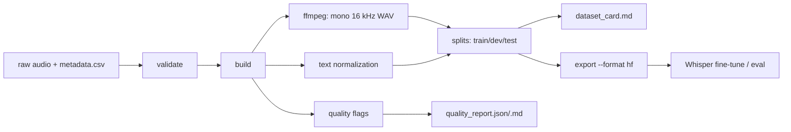

# dka

[](https://pypi.org/project/dka-speech/)
[](https://pypi.org/project/dka-speech/)
[](#license)

A dataset-preparation CLI for Philippine-language speech. `dka` turns raw recordings and transcripts into a reproducible, auditable, model-ready dataset package — normalized audio, clean metadata, speaker-disjoint splits, quality reports, and a dataset card — so speech work in Cebuano, Hiligaynon, Ilokano, Waray, and Filipino does not start with hand-written preprocessing scripts every time.

Website: https://dka.xy-800.workers.dev/

## Why

The Philippines has 130+ languages, but open ASR/TTS tooling covers very few of them. The bottleneck is no longer raw audio — corpora such as the UP-DSP Philippine Languages Database publish 450+ hours across Filipino, Cebuano, Hiligaynon, Ilokano, Waray, and Tausug. The bottleneck is the layer between "a corpus exists" and "I can train and compare on it": consistent audio formatting, transcript normalization, duplicate and duration hygiene, speaker-aware splits, and provenance that survives publication.

`dka` implements that layer once, as a file-format contract plus a CLI, so a dataset can be rebuilt byte-for-byte from its raw files and its `dka.yaml`.



## Install

```bash
pip install dka-speech
dka --help
```

From source:

```bash
git clone https://github.com/mr-jones123/dka && cd dka
uv sync
uv run dka --help
```

Audio conversion and SRT cutting shell out to `ffmpeg`, which must be on `PATH`.

## Quick start

```bash
uv run dka init my-dataset          # scaffold dka.yaml + raw/ + metadata.csv header
uv run dka validate my-dataset      # check audio paths, columns, empty transcripts
uv run dka build my-dataset         # process, split, report, write dataset card
uv run dka export my-dataset --format hf
```

Two bundled examples run as-is:

```bash
uv run dka validate examples/bisaya-commons
uv run dka build examples/bisaya-commons
```

`examples/bisaya-web` demonstrates subtitle segmentation: one source recording plus an `.srt` file, cut into sentence-level clips that inherit the row's metadata.

## Input contract

```text
dataset/
  dka.yaml
  raw/
    audio/*.{wav,mp3,m4a,flac,ogg}
    metadata.csv
```

`raw/metadata.csv` requires four columns; everything else is passed through to outputs.

```csv
id,audio_path,text,language
sample_001,raw/audio/sample_001.wav,"Maayong buntag",ceb
```

Recommended columns (carried through to `processed/metadata.csv` and the HF export): `speaker_id`, `domain`, `license`, `gender`, `age_group`, `region`, `recording_device`, `source`.

One special column: if `transcript_path` points at an `.srt`, the row's audio is treated as a container and each subtitle cue becomes an independent sample with id `<id>_<cue:04d>`, text taken from the cue. Use this for hymns, interviews, or broadcast footage with a timed transcript.

## Configuration

Every knob lives in `dka.yaml`; unspecified keys inherit defaults. `build` reads nothing else.

| Key | Default | Effect |
|---|---|---|
| `language`, `license`, `name`, `description` | `ceb`, `CC-BY-NC-4.0`, … | copied into the dataset card and reports |
| `input.metadata`, `input.audio_dir` | `raw/metadata.csv`, `raw/audio` | input locations |
| `audio.sample_rate` | `16000` | output sample rate |
| `audio.min_duration_sec` / `max_duration_sec` | `0.5` / `20` | duration bounds that raise `short_audio` / `long_audio` |
| `text.lowercase`, `trim_whitespace`, `remove_extra_spaces` | `true` | whitespace and case normalization |
| `text.strip_accents` | `true` | NFKD accent stripping (see Limitations) |
| `text.hyphens_to_spaces` | `true` | unifies `-`, `–`, `—` into spaces |
| `splits.strategy` | `speaker` | speaker-disjoint grouping when `speaker_id` is present |
| `splits.train` / `dev` / `test` | `0.8` / `0.1` / `0.1` | split ratios |
| `splits.seed` | `42` | deterministic split |
| `output.*` | `processed`, `splits`, `reports`, `dataset_card.md` | output locations |

## Output

```text
dataset/
  processed/
    audio/*.wav
    metadata.csv          # + normalized_text, duration_sec, sample_rate, quality_flags
  splits/
    train.csv  dev.csv  test.csv    # every column above, plus split
  reports/
    quality_report.json
    quality_report.md
  dataset_card.md
  exports/hf/             # after `export`
    train.csv  dev.csv  test.csv
```

Quality flags are counted per flag in `reports/quality_report.json`, and every row carries its own `quality_flags` JSON array:

| Flag | Raised when |
|---|---|
| `audio_unreadable` | output WAV cannot be parsed for duration |
| `short_audio` / `long_audio` | duration outside the configured bounds |
| `empty_text` | transcript is empty after normalization |
| `duplicate_text` | normalized transcript already appeared earlier in the run |
| `audio_convert_failed` | ffmpeg transcoding failed |
| `unsupported_audio_format` | extension outside `wav/mp3/m4a/flac/ogg` |
| `audio_segment_failed` | ffmpeg could not cut an SRT cue |

`validate` is the cheap pre-flight: it reports `missing_audio`, `unsupported_audio_format`, and `empty_text` counts, and raises if a required column is absent.

## Adapters

### UP-DSP-PLD importer

The UP-DSP Philippine Languages Database ships per-speaker session folders where a text `.log` interleaves metadata and one WAV/transcript pair per line:

```text
PLD/CEB/0200/0200.111020.092714.log
  SpeakerID = "0200"
  SpeakerDialect = "Cebuano - Northern Mindanao"
  0200.111020.092714.0007.wav "CEBUtt_aaaaa.txt" "Ayáw na págtagád."
```

`dka` parses both line shapes and maps speaker metadata into columns:

```bash
dka import-pld PLD/CEB my-dataset --limit 500
# or import and build in one step:
dka build PLD/CEB --preset pld --out datasets/pld-ceb-small --limit 500 --hf
```

`--preset pld` writes `speaker_id`, `gender`, `age_group`, `region`, `domain=pld`, `license=CC-BY-NC-4.0`, and `source=UP-DSP-PLD` into the generated `raw/metadata.csv`. `--limit` stops after N accepted rows, which keeps subsetting experiments reproducible.

### Hugging Face export

`export --format hf` (or `--hf` on `build`) writes CSVs with the columns Whisper's seq2seq pipeline expects:

| Column | Value |
|---|---|
| `audio` | absolute path to the processed WAV |
| `sentence` | normalized transcript |
| `language` | language code |
| `speaker_id` | speaker, when available |

## Training example

`scripts/train_whisper.py` fine-tunes a Hugging Face Whisper checkpoint directly from a `dka` export; `scripts/inference.py` transcribes a single file.

```bash
uv run dka build data/pld-ceb/PLD/CEB --preset pld --out datasets/pld-ceb-5k --limit 5000 --hf
uv run python scripts/train_whisper.py datasets/pld-ceb-5k --steps 500 --out runs/whisper-ceb-5k
uv run python scripts/inference.py runs/whisper-ceb-5k sample.mp3
```

The training script defaults to `openai/whisper-tiny`, `1e-5` LR, batch 2 with 4-step gradient accumulation, evaluation every 50 steps, and reports WER and CER.

Reference run — Cebuano subset of UP-DSP-PLD, built by `dka`, 500 fine-tuning steps:

| | |
|---|---|
| Samples | 5,000 |
| Audio | 6.51 hours |
| Speakers | 14 |
| Train loss | 19.95 → 2.15 |
| Eval loss | 1.08 → 0.62 |
| CER | 23.25% |
| WER | 64.93% |

This is a pipeline validation, not a strong Cebuano model: Whisper has no native Cebuano language token, so both scripts default `--language` to the nearest token (`tagalog`). The value is that the whole path — raw PLD files → `dka build` → HF export → fine-tune → inference — is reproducible from two commands.

## Repository layout

```text
src/dka/
  cli.py            # argparse entry point: init, validate, build, export, import-pld
  core.py           # config merge, build/validate, SRT segmentation, normalization, splits, reports
  adapters/pld.py   # UP-DSP-PLD .log parser and dataset writer
  adapters/hf.py    # Whisper-style CSV export
scripts/
  train_whisper.py  # Whisper fine-tuning from an export
  inference.py      # single-file transcription
frontend/           # Vite + React showcase of the CLI workflow
examples/
  bisaya-commons/   # 3 clips from MLCommons/speech-wikimedia
  bisaya-web/       # one flac + .srt, cut into 14 sentence clips
  pld-ceb-mini/     # one UP-DSP-PLD Cebuano session: 249 log rows, 10 bundled WAVs
SKILL.md            # machine-readable usage guide for coding agents
```

## Limitations

- Audio work requires `ffmpeg`; without it, conversion and SRT cutting fail and rows are flagged rather than silently dropped.
- `dka.yaml`'s `quality.*` block is declared but not yet wired — the configured flags are always computed. Treat the block as documentation of intent.
- Splits fall back to random when no `speaker_id` is present, which leaks speaker identity across train/test.
- `text.strip_accents` defaults to on, which removes Cebuano written accents. Set it to `false` for orthography-sensitive work.
- No test suite yet; verification is by running `validate` and `build` against the bundled examples.
- `dka` prepares datasets. It does not collect speech, augment data, or claim generated audio is real.

## Data and licensing

`dka` is MIT-licensed; that license covers the tool, not the data you put through it. Bundled examples carry their upstream terms —

- `examples/bisaya-commons` and `examples/bisaya-web`: clips and timed transcript from [MLCommons/speech-wikimedia](https://huggingface.co/datasets/MLCommons/speech-wikimedia) / Wikimedia Commons, CC-BY-NC-4.0. Verify each file on Commons.
- `examples/pld-ceb-mini`: UP-DSP Philippine Languages Database sample, CC-BY-NC-4.0.

Check consent, license, and speaker metadata before publishing any derived dataset. Do not strip quality flags silently — report them.

## Related work

- Philippine Languages Database — https://aclanthology.org/2024.sigul-1.32.pdf
- UP-DSP Philippine Languages Database — https://mozilladatacollective.com/datasets/cmmxhw46c00tqnw07xyr94zjk
- iTANONG-DS benchmark datasets — https://aclanthology.org/2023.icnlsp-1.34.pdf

## License

MIT © Xynil Jhed Lacap
